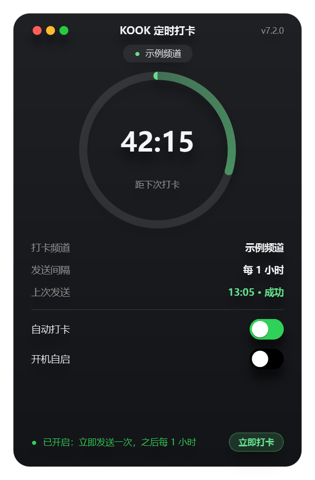
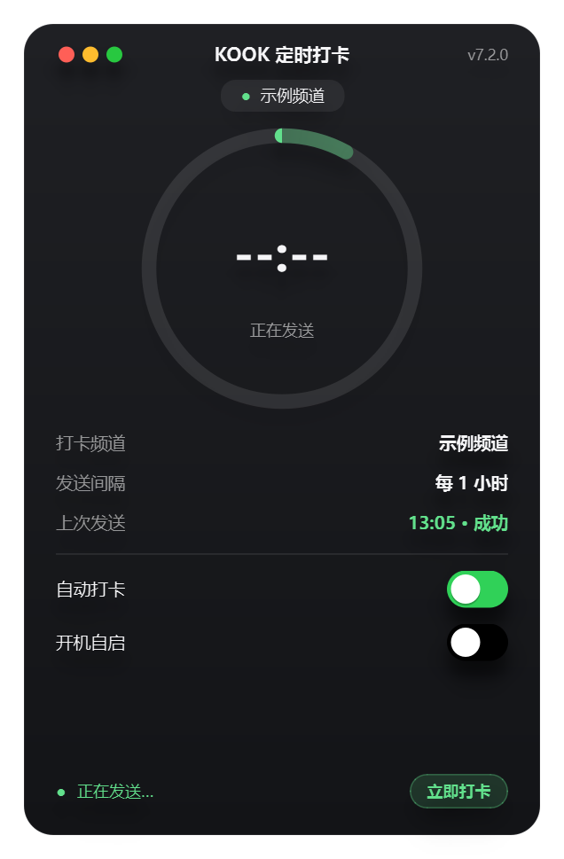
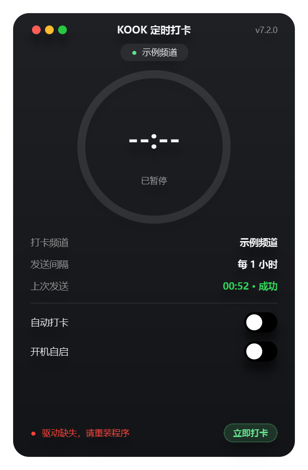
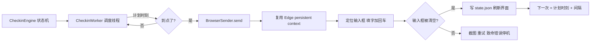

<div align="center">

# KOOK 自动打卡

**给 KOOK 频道用的定时小工具**：深色无边框卡片，托盘常驻，开机自启，
到点自动在指定频道发一条消息（默认「打卡」），发完就把自己藏回托盘。

[](https://github.com/YanChen1936/kook-checkin/actions/workflows/ci.yml)


[](LICENSE)



</div>

---

## 这是什么

一个 Windows 桌面程序，用很土但很管用的办法解决一件小事：**在 KOOK 频道里准点发一句话**。

它不接机器人、不要 API token、不要管理员权限——就是用本机 Edge 打开 KOOK 网页版，
找到输入框，把 `message` 打进去，按回车。所以任何频道都能用，只要你能手动发言。

> 不是官方工具，与 KOOK 官方无关。自动化发言可能违反某些服务器或频道的规则，
> 请自己判断能不能用、用在哪个频道（见文末「免责」）。

## 功能

- **准点不吃亏**：下一次发送 = 上一次**计划时刻** + 间隔，发送耗时（首轮常常 10 秒以上）不会一天天累积成漂移。
- **不会重复刷屏**：成功发送的时刻写进 `state.json`，重启、开机自启、打开窗口都续上次节拍；
  60 秒内点两次「立即打卡」也只会发一条。
- **发没发出去心里有数**：默认校验发送后输入框被清空；失败自动截图到 `shots/`，主界面直接显示「上次发送」结果。
- **内存不乱吃**：浏览器上下文复用，空闲 15 分钟自动关掉 Edge 释放内存，下次发送再拉起。
- **睡过头有交代**：电脑休眠跨过发送点，按 `catch_up_missed` 决定是立即补一条还是干脆跳过，日志写清楚。
- **日志克制**：主日志一行一件事，异常只留 `类型: 首行`，完整 traceback 进独立的 debug 日志；
  Playwright 的启动命令行再也不会灌进你的日志。
- **该停就停**：驱动缺失这类修不了的错误不再每小时空转四次，而是停下并在界面上告诉你怎么办。
- 托盘常驻、开机自启、单实例互斥、`--quit` 优雅退出、`--auto` 静默启动。

## 界面

<table>
  <tr>
    <td align="center"><br><sub>运行中：圆环倒计时</sub></td>
    <td align="center"><br><sub>正在发送：圆环转进度</sub></td>
    <td align="center"><br><sub>致命错误：停下并给提示</sub></td>
  </tr>
</table>

## 快速开始

### 1. 拿到程序

到 [Releases](https://github.com/YanChen1936/kook-checkin/releases) 下载 `kook-checkin-win64.zip`，
解压到**固定目录**（例如 `%LOCALAPPDATA%\Programs\KOOK打卡\`），双击 `KOOK打卡.exe`。

不要用 PyInstaller onefile 版本——那会把浏览器驱动解包到 `%TEMP%`，被系统清理后就永久报错，
原因见后面的「设计笔记」。本项目只发布 onedir。

### 2. 第一次运行：填频道地址

程序会在 `%LOCALAPPDATA%\KOOKCheckin\config.json` 写一份默认配置，把这两行改成你自己的：

```json
{
  "channel_url": "https://www.kookapp.cn/app/channels/1234567890123456/7654321098765432",
  "channel_display": "我的频道"
}
```

怎么拿这个地址：浏览器打开 [kookapp.cn](https://www.kookapp.cn)，进目标频道，**直接复制地址栏**。
两段数字分别是服务器 ID 和频道 ID。

> 仓库里不含任何真实频道地址，默认值是空的；没填时程序会停下并在底部提示「尚未配置打卡频道」。

### 3. 登录一次

第一次发送时程序会启动 Edge 打开你的频道。如果没登录，会等你登录（默认最多 5 分钟），
登录态存在 `%LOCALAPPDATA%\KOOKCheckin\kook_profile\`，以后不用再登录。

### 4. 打开「自动打卡」和「开机自启」

两个开关一开就行。关掉主窗口程序不会退出，缩在托盘里继续计时。

## 配置

`%LOCALAPPDATA%\KOOKCheckin\config.json`，全部字段都有默认值，改完重启程序生效：

| 字段 | 默认 | 说明 |
| --- | --- | --- |
| `channel_url` | 空 | 目标频道链接，**必填** |
| `channel_display` | 我的频道 | 界面上显示的名字，随便写 |
| `message` | 打卡 | 每次发送的内容 |
| `interval_seconds` | 3600 | 发送间隔（秒） |
| `nav_timeout_ms` | 60000 | 打开页面超时（毫秒） |
| `login_wait_seconds` | 300 | 等你手动登录的时长（秒） |
| `edge_path` | 系统 Edge | 浏览器路径；不存在时退回 Playwright 的 `msedge` 通道 |
| `input_selectors` | 见源码 | 输入框选择器列表，KOOK 网页改版时才需要动 |
| `log_max_bytes` | 524288 | 主日志轮转阈值 |
| `send_verify` | true | 发送后校验输入框被清空 |
| `max_retry` | 3 | 非致命错误重试次数 |
| `keep_browser_alive` | true | 复用浏览器上下文（省掉每轮 10–20 秒启动） |
| `idle_close_seconds` | 900 | 空闲多久关浏览器释放内存，0 = 一直保活 |
| `catch_up_missed` | true | 休眠/卡死跨过计划时刻后是否立即补发一次 |

## 工作原理



| 模块 | 职责 |
| --- | --- |
| `config.py` | Config dataclass、config.json 读写与类型兜底、开机自启注册表 |
| `state.py` | `state.json`：上次成功发送时刻、续节拍与去重判断 |
| `engine.py` | `CheckinWorker`（QThread）+ 状态机：计划时刻、补发、空闲释放 |
| `sender.py` | Playwright 发送器：上下文复用、登录引导、发送校验、失败截图 |
| `logbus.py` | 单消费线程日志、轮转、异常摘要、独立 debug 日志 |
| `widgets.py` / `window.py` | 自绘控件、无边框卡片窗口、托盘 |
| `main.py` | 单实例互斥、`--auto` / `--quit` |

## 设计笔记：这一版是从日志里长出来的

最初的版本能用，但后来每小时发 4 条一模一样的错误：

```text
[2026-11-12 14:48:18] 已发送「打卡」          <- 最后一小时正常
[2026-11-12 15:48:21] 发送异常: [WinError 2] 系统找不到指定的文件。
[2026-11-12 15:48:22] 发送异常: [WinError 2] 系统找不到指定的文件。
[2026-11-12 15:48:26] 发送异常: [WinError 2] 系统找不到指定的文件。
[2026-11-12 15:48:30] 发送异常: [WinError 2] 系统找不到指定的文件。
```

查下来和账号、选择器都没关系：**打包方式**。旧版是 PyInstaller onefile，运行时把 playwright 驱动解包到
`%TEMP%\_MEIxxxx`；进程一直开着，系统清理临时文件时把那个目录删了，
于是每次 `subprocess` 启动 `node.exe` 都报 WinError 2。旧进程解包目录里
`playwright\driver` 只剩 `package`、没有 `node.exe`，而新解包的目录里有——对照一下就明白了。

三处改动直接来自这条线索：

| 症状 | 根因 | 现在 |
| --- | --- | --- |
| 报 WinError 2 | onefile 解包到 `%TEMP%`，被清理即死 | **onedir**，驱动常驻安装目录 |
| 一小时 4 条相同错误 | 致命错误被当成网络抖动，1s/2s/4s 退避重试 | 致命错误不重试，引擎停下并提示怎么修 |
| 日志被撑到 167 KB | Playwright 把整条 msedge 命令行写进日志 | 主日志一行摘要，traceback 进 debug 日志 |

后续又对着真实日志修掉四个调度缺陷：计划时刻漂移、休眠跨点整轮丢失、发送中连发两次、
保活却不释放内存。每个都有单元测试守着，见 `tests/test_engine.py`。

## 开发

```powershell
git clone https://github.com/YanChen1936/kook-checkin.git
cd kook-checkin
python -m venv .venv
.venv\Scripts\pip install PySide6 playwright

.venv\Scripts\python.exe run.py                             # 开发运行
.venv\Scripts\python.exe run.py --auto                      # 模拟开机自启（续节拍，不补发）
.venv\Scripts\python.exe -m unittest discover -s tests -v   # 18 个用例，约 20 秒
.venv\Scripts\python.exe build.py                           # 打包 -> dist\KOOK打卡\
```

打包用 PyInstaller onedir，会剔除未使用的 Qt 组件（约 182 MB，其中 playwright 驱动 113 MB）。
部署脚本 `tools\deploy.ps1` 只对**末段名等于应用目录名**的目标做 `robocopy /E` 同步，
绝不 `/MIR`；含中文的 .ps1 必须存成 UTF-8 **with BOM**，否则 PowerShell 5.1 会按 ANSI 解析。

## 常见问题

**启动就报「驱动缺失 / WinError 2」**
说明用的是 onefile 版本，或者安装目录被搬动过。换 onedir 版本，重新解压到固定目录。

**提示「尚未配置打卡频道」**
`config.json` 里的 `channel_url` 还是空的，按「快速开始」第 2 步填。

**发送失败，提示找不到输入框**
KOOK 网页改版了，需要更新 `input_selectors`；失败截图在
`%LOCALAPPDATA%\KOOKCheckin\shots\`（最多留 8 张）。

**Edge 起不来 / 一直转圈**
检查 `edge_path` 是否存在；同一份 `kook_profile` 不能被两个实例同时使用，
确认没有残留进程（`KOOK打卡.exe --quit` 可以让在跑的实例自己退出）。

**为什么不用 KOOK 官方机器人 API？**
机器人要先被拉进服务器、还要管理员授权，而且发言身份和你本人不一致。
这个工具的目标是「用你自己的号，在任意有权限的频道发言」。

## 已知限制

- 只支持 Windows 10/11，依赖本机 Edge（或 Chromium 内核浏览器）。
- 靠网页结构定位输入框，KOOK 大改版可能需要小更新。
- 不做验证码 / 风控绕过；需要人工验证时程序会等你操作（默认 5 分钟）。
- 只发文本消息，不发图片、不 @ 人。

## 免责

本项目是个人自用工具的公开版本，与 KOOK 官方没有任何关系。请确保你在目标频道有发言权限，
并且自动化发言不违反该服务器或频道的规则。因使用本工具导致的账号或社群问题由使用者自行承担。

## License

[MIT](LICENSE)

<details>
<summary>English</summary>

A tiny Windows tray app that sends a scheduled message (default `打卡`) into a KOOK channel
by driving the KOOK web client through Playwright. PySide6 UI, single instance, autostart,
drift-free scheduling, send verification, and logs that stay readable.

Not affiliated with KOOK. Copy the channel URL from your browser into
`%LOCALAPPDATA%\KOOKCheckin\config.json` and you are done.

</details>
